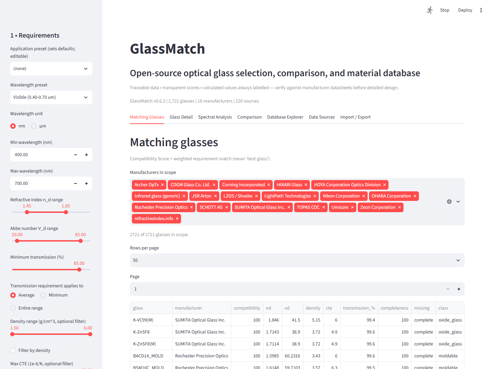
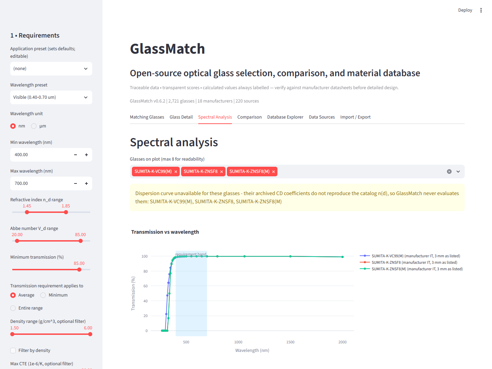
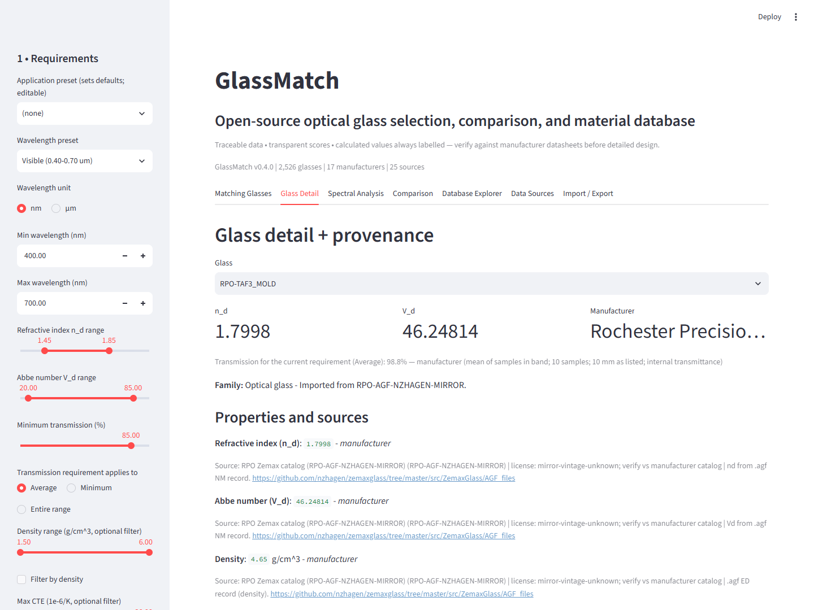
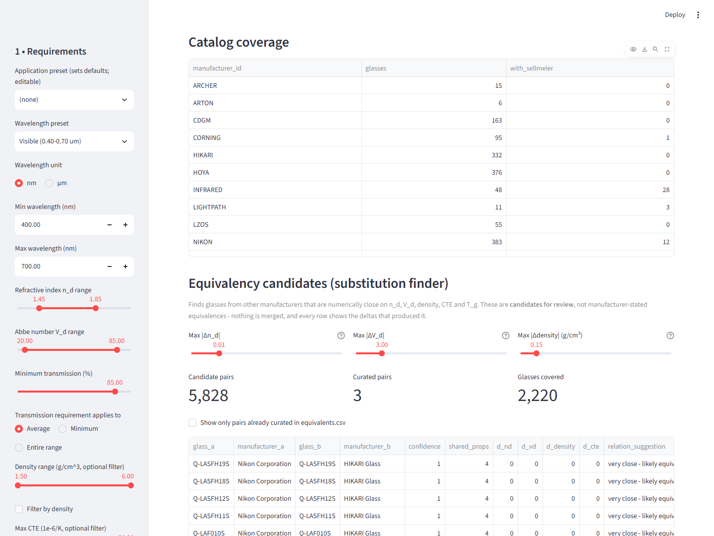
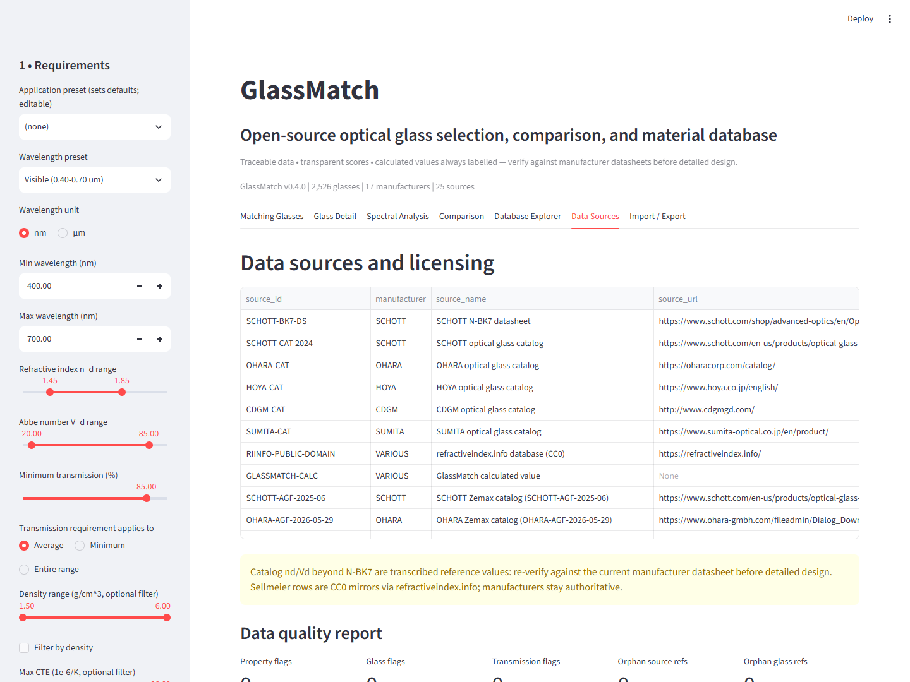

# GlassMatch

[](https://github.com/br24563/Glass-Match/actions/workflows/ci.yml)
[](https://www.python.org/downloads/)
[](LICENSE)

Open-source optical glass selection, comparison, and material database.
**2,959 materials · 18 source collections · 364 traceable sources** · data
version pinned by [`MANIFEST.json`](data/normalized/MANIFEST.json) ·
[how the data is validated](docs/VALIDATION.md) — search,
rank, compare, and inspect provenance for oxide glasses, crystals, IR
materials, polymers, and moldables.







> Screenshots captured from a live run (`start.bat`); regenerate with
> `python scripts/capture_screenshots.py` (needs `pip install playwright` and a
> local Microsoft Edge install).

## Features

- Requirement-driven matching (wavelength band, n_d, V_d, transmission,
  density, CTE) with transparent Compatibility Scores and user-adjustable weights.
  Maker-scoped, paginated results scale to thousands of glasses.
- **Transmission modes**: Average / Minimum / Entire range, evaluated against
  manufacturer IT rows (70k samples), then transmission calculated from
  tabulated n and k; a glass with neither has only its uncoated Fresnel
  reflection loss, which ignores absorption, so that is shown as an upper
  bound and never meets a requirement. Entire range refuses to score when
  band coverage < 90%.
  Catalogs list internal transmittance at different thicknesses (SCHOTT
  25 mm, most others 10 mm, some 1-3 mm); every sample is converted to one
  user-chosen sample thickness by Beer-Lambert, T_d = T^(d/d_listed), and
  labelled as scaled, so glasses are compared on the same path length.
  Conflicting duplicate samples are excluded (never pick-a-winner) and disclosed.
  **Several bands at once** (e.g. 400-700 nm *and* 9-10 µm for a dual-band
  window): every band must meet the requirement, each band's figure is
  shown, the combined figure is the worst band, and a band with no data
  makes the glass missing, never passing.
- **Thermal and mechanical data**: absolute dn/dT (d line, +20/+40 C) for
  1,819 materials - HIKARI's own figures, or calculated from each catalog's
  TD coefficients with the SCHOTT dn/dT formula - with an optional |dn/dT|
  limit for athermal designs; relative cost and climate/stain/acid/alkali/
  phosphate resistance classes from the .agf OD records; and T_g, thermal
  conductivity, Young's and shear modulus, Poisson's ratio, stress-optic
  coefficient, Knoop hardness, specific heat and powder-method chemical
  resistance from each maker's own Excel data workbook, for 1,057 glasses
  (table below).
- **IR and other bands**: V and P for any wavelength triad (MWIR, LWIR ...),
  a band glass map and band pair finder (e.g. LWIR achromats), CDGM's
  chalcogenide fits verified against CDGM's own IR index tables, and bands
  that must have transmission data so opaque glasses don't clutter an IR
  search.
- **Index at any temperature and pressure**: n(λ, T, p), relative or
  absolute, from the SCHOTT dn/dT model inside its stated validity or the
  maker's own measured dn/dT tables (116,639 values from five makers'
  workbooks), with the method shown and nothing extrapolated
  ([VALIDATION.md §8](docs/VALIDATION.md)).
- **Lens glass replacement** (first-order screening; each replaced element
  keeps its own power by default, the modified design is written back into
  the original .zmx / .seq, `glassmatch audit` scans a folder of designs for
  obsolete glasses): load a prescription
  (JSON, CSV, Zemax .zmx, CODE V .seq), get EFL, BFL, axial colour,
  secondary spectrum and thermal focus shift for a mount CTE, and rank
  available glasses to replace an obsolete one - curvatures kept, or one
  re-solved to restore the focal length. Paraxial only; verify any change in
  an optical design program. Example: `docs/examples/doublet.*`.
- **Glass map**: interactive n_d vs V_d Abbe diagram coloured by maker,
  obsolete glasses hidden by default and the current match results ringed;
  a second view plots P_g,F vs V_d with the normal line and dPgF for
  secondary-spectrum work. P_g,F is not a stored property: it is
  **calculated** from each glass's verified dispersion fit (n_g, n_F, n_C)
  for 2,719 glasses, only where the fit's stated range covers 435.8-656.3 nm,
  and the manufacturer's own dPgF is shown beside the calculated one.
- **Pair finder** (`glassmatch/pairs.py`): ranks two-glass achromatic
  doublets by low element powers, low secondary spectrum, apochromat
  candidates (near-equal P_g,F, large dV) or athermal residual for a given
  mount CTE, over the non-obsolete glasses by default, filtered by maker,
  material class, the sidebar transmission requirement and compatibility
  score. Vectorised: ~2,000 glasses (two million pairs) rank in well under a
  second. Every number is calculated (first-order thin lenses in contact)
  and labelled as a starting point, never a manufacturer recommendation.
- **Data quality report**: range checks, duplicate detection, missing-source
  checks and orphan source references — flags are listed for review, never
  auto-fixed.
- **IR mode**: for chalcogenide/IR glasses (no meaningful V_d), matching scores
  n_d + transmission band instead of penalizing the missing Abbe number.
- Provenance-first database: every value carries source, license, and
  data_type (manufacturer / calculated / interpolated / user_imported).
- **Cross-manufacturer substitution finder**: computes candidate equivalents
  from n_d, V_d, density, CTE and T_g with adjustable tolerances. Candidates are
  flagged for review and never auto-merged; curated (source-backed) pairs are
  shown separately and are never overwritten.
- Interactive Plotly dispersion + transmission plots (calculated curves labelled).
  Every catalog's coefficients are evaluated in the formula its `.agf` names
  (Schott, Sellmeier 1/3/5, Herzberger, Conrady, Extended 2/3 ... — all 13
  Zemax forms), and a curve is drawn **only** when that reproduces the catalog
  n_d within 2×10⁻⁴ *and* V_d within 0.5 — 2,574 materials, worst residuals
  3.8×10⁻⁵ and 0.23. IR crystals whose catalog has no n_d (Zemax writes 1.0)
  are instead checked against a named room-temperature measurement of the same
  material (Si, Ge, GaAs, CdTe, ZnSe, ZnS). Curves are never drawn outside the
  fit's stated wavelength range. The 19 rows that pass neither check are
  stored verbatim and **never** evaluated, and the UI says so.
- **Crystal materials** — 199 pages covering CaF₂, MgF₂, BaF₂, SrF₂, LiF, LaF₃,
  sapphire, fused silica/quartz, spinel, YAG, ZnSe, ZnS, Ge, Si, CdTe, GaAs and
  Te, from [refractiveindex.info](https://refractiveindex.info) (public domain,
  **CC0 1.0**, so unlike the manufacturer catalogs it ships with the repo). Each
  cites the paper it came from. Crystals have no n_d/V_d, so the detail page
  gives you a **reference-wavelength control** and tells you whether the number
  is a source measurement, an interpolation between samples, or an evaluation
  of a published dispersion fit (all nine refractiveindex.info formulas,
  including the constant term of formulas 1/2) — and says "unavailable"
  rather than extrapolating when the request falls outside the range the
  source states.
- Glass detail pages, 2-5 glass comparison, database + source explorers
  (material-class filter, obsolete toggle driven by each catalog's own status
  field — 1,156 discontinued glasses — per-maker coverage table).
- User CSV + manufacturer `.agf` import with validation; CSV/JSON export
  with provenance preserved.
- **Zemax OpticStudio export** (`glassmatch/export_agf.py`): the matching
  results or a comparison selection download as an `.agf` glass catalog
  (NM/ED/CD/TD/OD/LD/IT records) that loads straight into OpticStudio.
  Values are written verbatim from the source catalogs, with each glass's
  source catalog and its date in the `CC` header; only verified dispersion
  fits are exported - archived fits never are, and refractiveindex.info
  crystal fits only where a Zemax formula is the identical expression
  (the others are listed as skipped). Re-importing the file reproduces
  n(λ), n_d, V_d, CTE, TD and every transmission sample exactly; for the
  whole database that is 2,749 of 2,959 materials.
## Installation

**Easiest (Windows):** double-click `start.bat`. First run creates an isolated
`.venv` and installs dependencies (uses `uv` if available, ~1 s, else pip);
every run after that just opens the app at `http://localhost:8501`.

**Manual** (Windows cmd, PowerShell, macOS or Linux):

```text
git clone https://github.com/br24563/Glass-Match.git GlassMatch
cd GlassMatch
python -m pip install -r requirements.txt
python -m streamlit run app.py
```

`python -m ...` runs pip and Streamlit through the Python you just used, so
it works even when pip's Scripts folder is not on PATH (the usual cause of
"'streamlit' is not recognized" on Windows). Python 3.10 or newer.

**First time?** [docs/QUICKSTART.md](docs/QUICKSTART.md) walks through the
common jobs: find a glass, search two bands at once, index at temperature,
athermal pairs, and replacing an obsolete glass in a lens.

**As a Python package** (library + `glassmatch` command + the bundled
database; the web app is the `[app]` extra):

```text
pip install "glassmatch[app] @ git+https://github.com/br24563/Glass-Match"
```

Works offline once installed; no servers, keys, or cloud services.

The first start parses the CSV database and caches it (and the default
results of the heavier pages) as Parquet in a per-user cache
(`%LOCALAPPDATA%\glassmatch\cache`, or `~/.cache/glassmatch`); later starts
read that. The cache is keyed to the data, the package version and the code,
so it is never stale. `GLASSMATCH_CACHE=0` turns it off.

### Command line

```text
glassmatch version                      # package + data version, counts
glassmatch info N-BK7                   # every property with its source
glassmatch n N-BK7 486.1 587.6 1064     # index; never extrapolated
glassmatch search --nd 1.5:1.55 --vd 60:70 --preferred --top 10
glassmatch search --nd 1.6:1.8 --band 0.4:0.7 --tmin 99 --thickness 10 --csv out.csv
glassmatch search --band 0.4:0.7 --band 9:10 --tmin 80 --require-data   # both bands
glassmatch export-agf SCHOTT-N-BK7 OHARA-S-BSL7 -o shortlist.agf
glassmatch search --vd 55:75 --where athermal_gamma_air=-1:1 --sort athermal_gamma_air
glassmatch search --where acid_resistance@OHARA=1:2   # maker scales: name the maker
glassmatch search --nd 1.45:1.55 --columns gvd,group_index --wavelength 800 --sort gvd
glassmatch columns                      # every sortable column and its meaning
glassmatch n2 --material CaF2           # nonlinear-index measurements
glassmatch n N-BK7 587.6 -T -40         # index at -40 C (relative to air there)
glassmatch n N-BK7 587.6 --pressure 0   # in vacuum; --absolute for absolute index
glassmatch dndt S-FPL51 1550 --t1 -20 --t2 0 --relative
glassmatch lens design.zmx -T 60 --mount-cte 23.6   # EFL, BFL, colour, thermal focus
glassmatch replace design.zmx           # rank replacements for its obsolete glasses
glassmatch replace design.seq N-SF5 --maker SCHOTT --resolve-surface 3
glassmatch replace design.zmx N-SF5 --use E-FD5 --use-maker HOYA -o new.zmx
glassmatch audit designs/ --csv obsolete.csv    # obsolete glasses in a folder
glassmatch band --preset LWIR                   # V and P at 8/10/12 um
glassmatch lens ir_design.zmx --design-band LWIR -T 60   # IR lens, thermal focus
glassmatch search --band 8:12 --tmin 50 --require-band-data
glassmatch export-codev N-BK7 E-FD5 -o private.seq   # CODE V private catalog
glassmatch check                        # data matches its manifest
```

`python -m glassmatch ...` is the same. In Python:
`from glassmatch import load_default_database, match_glasses, data_version`.

## Sortable properties

The *Search & Compare* tab (Browse the whole database) shows every column below and sorts on any of them; the
matching sidebar's **More columns & filters** adds any as a results column or
a range filter (missing values are kept unless "Require available data" is
on); `glassmatch search --columns/--where/--sort` does the same.
`glassmatch columns` lists them all.

* **Catalog properties** - n_d, V_d, ΔP_g,F, density, CTE (−30/+70 and
  20/300 °C), T_g, strain / annealing / softening / yield (sag) points,
  conductivity, specific heat, Young's and shear modulus, Poisson's ratio,
  stress-optic coefficient, Knoop hardness, flexural strength, dn/dT
  (absolute d line; SCHOTT also e / g / 1060 nm; OHARA relative at 1550 nm),
  colour codes (λ80/λ70/λ5, total and internal), transmission range, relative
  cost, melt / production frequency.
* **Per-maker scales** - abrasion, ISO grindability, climate / stain / acid /
  alkali / phosphate resistance. Shown and filterable, labelled "maker's own
  scale"; not comparable across makers.
* **Calculated** (labelled; verified fits only, never extrapolated) - n_e,
  V_e, P_g,F, P_C,t, ΔP_g,F for every fit; n, dn/dλ, group index and GVD at a
  chosen wavelength; the internal UV edge (λ at 80 % / 5 %) and internal
  transmittance at 355 / 532 / 1064 / 1550 nm at the chosen thickness; the
  athermal coefficient γ = (dn/dT)/(n−1) − α, in air (relative dn/dT) and
  in vacuum (absolute); the thermal-shock figure
  k(1−ν)/(αE); specific stiffness E/ρ.
* **Nonlinear index n2** - 161 published measurements for 17 crystals, in
  their own table (one row per paper, with wavelength, pulse duration and
  method; never averaged).

How each calculated figure was checked against manufacturer data is in
[`docs/VALIDATION.md`](docs/VALIDATION.md).

## Availability

`status` is each catalog's own availability class (the Zemax NM status
field): **preferred** (the maker's recommended line), **standard**,
**special**, **melt** (made to order) and **obsolete**. Where a maker's own
workbook is newer or more specific than its `.agf`, it wins: SCHOTT's
November 2025 workbook lists 34 glasses as **inquiry** (orderable on request,
e.g. "N-LAF35 moved to inquiry glasses") that its June 2025 `.agf` marks
obsolete or preferred, and OHARA's special-order workbook lists 14 glasses its
`.agf` marks obsolete. The matching sidebar, `glassmatch search` and the pair
finder hide obsolete glasses by default; `--preferred` / the Availability
filter narrows to the makers' preferred lines. HIKARI and the mirror-only
makers publish no preferred class.

## Validation and data versions

[`docs/VALIDATION.md`](docs/VALIDATION.md) lists every check the data passes,
with the numbers. In short: every fit reproduces its catalog n_d and V_d, and
888 fits were compared with the makers' own datasheets at 11-20 spectral lines
from the i line to 2.3 µm - 96.7% agree within 2×10⁻⁵ at every line, the worst
by 4.8×10⁻⁵ (at the UV end).

The database carries a **data version** (`YYYY.MM.DD` of its last change) in
`data/normalized/MANIFEST.json`, which pins every file by SHA-256. The app
shows it, every export (CSV, JSON, `.agf`) records it, and CI fails if the data
changes without it - so a design can cite exactly which numbers it used.

## Running tests

```text
pip install -r requirements-dev.txt
python -m pytest tests -q
```

The matching algorithm and database layer are tested without Streamlit;
`streamlit.testing.v1.AppTest` exercises the full app script end-to-end.

## Example workflow

1. Pick the Visible preset (0.40-0.70 um), set n_d 1.45-1.60 and V_d 55-75
   for a low-dispersion crown search.
2. Weight transmission 35%, V_d 25%, n_d 25%.
3. Scope makers (e.g. SCHOTT + OHARA), page through ranked Compatibility
   Scores — N-BK7-class glasses surface at top.
4. Open Glass Detail to check the SCHOTT source row before designing.
5. For MWIR (3-5 um): pick the MWIR preset — chalcogenide/IR glasses are
   scored on n_d + transmission band (V_d skipped, shown as n/a).

## Matching algorithm

Per-property score is 1.0 inside the required band with linear falloff
outside. Overall = weighted mean over available data x (0.5 + 0.5 x covered
weight). Missing data lowers completeness instead of silently failing,
unless Require available data is on. Weights auto-normalize to 100%.

**IR mode** (`material_class=chalcogenide` or maker INFRARED/LIGHTPATH/UMICORE):
V_d is physically meaningless, so its weight is redistributed to n_d and
transmission and the glass is never penalized for the missing value.

Transmission requirement modes: **Average** = mean of manufacturer samples in
band; **Minimum** = worst sample; **Entire range** = worst sample but only
when samples span ≥90% of the band (otherwise reported missing, not guessed).
Manufacturer IT rows are preferred, then transmission calculated from
tabulated n and k. For a glass with neither, the uncoated Fresnel reflection
loss is stated as an upper bound only: it ignores absorption (it put LiF at
99 % over 9-10 um, where LiF is opaque), so the glass counts as missing and
never meets a transmission requirement on it.

## Glass pairs

Thin lenses in contact, total power φ, element 1 = higher V_d (crown):

| Quantity | Formula |
|---|---|
| Achromat power split | φ1 = φ·V1/(V1−V2), φ2 = −φ·V2/(V1−V2) |
| Secondary spectrum (g-F focal shift / f) | (P1−P2)/(V1−V2), P = P_g,F |
| Normal line (SCHOTT, K7/F2) | P_g,F = 0.6438 − 0.001682·V_d |
| Thermo-optic coefficient | γ = (dn/dT)/(n_d−1) − α  (1e-6/K) |
| Doublet focal drift | (1/f)·df/dT = −(φ1γ1 + φ2γ2)/φ |
| Athermal residual | focal drift − mount CTE (0 = athermal) |

Textbook check (tested): N-BK7 / N-F2 (V_d 64.17 / 36.37) gives
φ1 = 2.308φ, φ2 = −1.308φ — a 100 mm doublet with a 43.3 mm crown and a
−76.4 mm flint. dn/dT is the d-line value, +20/+40 C - relative to air for
a lens in air (the default), absolute in vacuum - and α the catalog CTE
(−30/+70 C), so the athermal ranking covers the 1,790
glasses that have both. Treat the results as a shortlist for a lens-design
program, not a design.

## Database architecture

- `manufacturers.csv`, `glasses.csv`, `properties.csv` (long format with
  source_id + data_type), `sources.csv`, `sellmeier.csv` (+`transmission.csv`,
  `equivalents.csv`).
- `material_class` ∈ {oxide_glass, crystal, chalcogenide, polymer, moldable},
  `status` ∈ {preferred, standard, special, melt, inquiry, obsolete} (each
  catalog's own availability class; see "Availability" below); both default
  safely on legacy files.
- `spectral_nk.csv` holds tabulated optical constants (wavelength, n, k) for
  crystal pages, verbatim with a per-row `source_id`.
- Dispersion rows (`sellmeier.csv`) keep the coefficients verbatim in
  `coefficients` with the equation they belong to in `zemax_formula` or
  `rii_formula`; the `B*`/`C*` columns are filled only for pure Sellmeier
  sums. A row is plottable only if the importer earned it a verified label
  (`Sellmeier-1 (...)`, `Schott (Zemax formula 1, ...)`, ...) by reproducing
  the catalog n_d and V_d, or, for placeholder-n_d IR crystals, by
  `scripts/verify_ir_dispersion.py`. Everything else is stored as
  `Non-dispersable (...) - archived, never evaluated`, with the measured
  discrepancy in the label.
- Add a manufacturer: append rows to `manufacturers.csv`/`sources.csv`,
  then glasses + properties — or run `scripts/merge_agf.py` on a staged `.agf`.
  No matching/UI code changes.
- Add a glass: append one `glasses.csv` row + N `properties.csv` rows.

See **[CONTRIBUTING.md](CONTRIBUTING.md)** for the full workflow, including how to
add a manufacturer without writing any Python. Release history is in
**[CHANGELOG.md](CHANGELOG.md)**.

## Database contents (committed, 2026-09)

| Maker file | Glasses | Notes |
|---|---|---|
| SCHOTT June-2025 `.agf` + IRG infrared `.agf` (July 2018) | 372 | Manufacturer, current (re-checked 2026-10-20: unchanged); 6 IRG chalcogenide glasses with 10 mm transmission, fits checked against SCHOTT's IRG datasheets |
| OHARA May-2026 `.agf` | 433 | Manufacturer, current |
| HOYA July-2026 `.agf` (incl. obsolete) | 436 | Manufacturer, current; 1 mirror-only legacy glass kept as obsolete |
| CDGM Sept-2026 `.agf` | 375 | Manufacturer, current; 23 mirror-only legacy glasses kept as obsolete |
| SUMITA Aug-2026 `.agf` (incl. discontinued) | 433 | Manufacturer, current |
| HIKARI June-2025 catalog workbook + Nikon 2019 `.agf` | 397 | 155 current HIKARI glasses (with thermal/mechanical data); 235 discontinued HIKARI and 7 Nikon NIFS/NICF from Nikon's 2019 Zemax data |
| LZOS / Corning | 150 | nzhagen/zemaxglass mirror, vintage unknown (no public catalog found) — verify before design |
| IR (generic/LightPath/Umicore) | 61 | Chalcogenide + crystal entries; IR mode applies |
| Polymers (Zeon/Arton/Topas/Archer) + RPO moldables | 70 | Polymer/moldable classes |
| **Total** | **2,959** | 2,789 verified dispersion curves · 22 archived non-dispersable · 148 with no curve · 232 CC0 crystal pages · 71k transmission rows · 143k tabulated n/k samples |

1,202 glasses are marked obsolete, from each catalog's own status field (or,
for HIKARI, absence from the current catalog); the whole-database browse view hides
them by default. HIKARI glasses are listed once, under HIKARI: Nikon's 2019
file distributes the same line, and the old mirror had most of them twice.

Thermal and mechanical coverage (glasses with a value, from the makers' own
Excel data workbooks):

| Property | SCHOTT | OHARA | CDGM | HIKARI | HOYA |
|---|---|---|---|---|---|
| T_g | 156 | 161 | 347 | 155 | 238 |
| Thermal conductivity | 147 | 161 | 157 | 155 | 238 |
| Young's modulus | 155 | 161 | 336 | 155 | 224 |
| Shear modulus | 0 | 161 | 335 | 155 | 224 |
| Poisson's ratio | 155 | 161 | 327 | 155 | 224 |
| Stress-optic coefficient | 154 | 161 | 296 | 155 | 201 |
| Knoop hardness | 156 | 161 | 345 | 155 | 238 |
| Specific heat | 147 | 0 | 157 | 155 | 238 |
| Water / acid resistance, powder method | 33 / 32 | 161 / 161 | 347 / 347 | 155 / 155 | 238 / 0 |

SCHOTT's workbook covers its 159 current preferred and inquiry glasses,
OHARA's three workbooks (S, L and special-order) 161 glasses, CDGM's every
glass in its current catalog, HOYA's 238 glasses. Units are confirmed from
each workbook - its headers, SCHOTT's Description sheet, HOYA's data-sheet
page, and E = 2G(1 + nu) on every CDGM, OHARA and HOYA row; CDGM's Knoop
hardness is stored as printed, in 1e7 Pa. HOYA's site refused connections
on 2026-10-28, so HOYA's figures come from its 2026-04-01 workbook as
redistributed by the open-source opticalglass package, recorded under the
mirror source `HOYA-XLSX-2026-04-01-MIRROR` until HOYA's own current file
(2026-06-01) can be downloaded.

Duplicate NM names across mold variants (HOYA E-FL6/FD-series, Nikon E-series)
are disambiguated with status-flag suffixes — zero duplicate `glass_id`s.

## Data sources and licensing

- Manufacturer catalogs (SCHOTT, OHARA, HOYA, CDGM, SUMITA `.agf`; HIKARI's
  Excel workbook; SCHOTT's, OHARA's and CDGM's Excel data workbooks; Nikon's
  Zemax data; HOYA's workbook for now via a third-party mirror, labelled
  so): authoritative, redistribution-limited —
  the files stay in untracked `data/staging/` (`data/staging/official/<maker>/`
  for the 2026-10 downloads); only normalized rows ship. Each `sources.csv`
  row records the download page, publication date and access date.
- Mirror `.agf` files (LZOS, Corning, IR and polymer makers, which publish no
  current catalog): `mirror-vintage-unknown; verify vs manufacturer catalog`.
- Every glass value comes from a parsed catalog record; nothing is
  hand-transcribed. The curated substitution pairs in `equivalents.csv` cite
  the manufacturer catalogs as cross-references only.
- No scraping behind access controls.

**Crystals and tabulated optical constants are a different case.** The 199
crystal pages under `data/spectral/refractiveindex_info/` come from the
[refractiveindex.info](https://refractiveindex.info) database, which its
maintainer placed in the **public domain under CC0 1.0** ("you may copy,
modify, and distribute ... even for commercial purposes, without asking
permission"). Those files are therefore *committed here* — they are the
provenance for every crystal number, and the licence permits it. Each page
records the paper it was taken from, and GlassMatch carries that citation
through to `sources.csv` (e.g. CaF2 n_d <- Malitson, *Appl. Opt.* **2**, 1103
(1963), DOI `10.1364/AO.2.001103`). The underlying papers remain the property of
their authors; GlassMatch redistributes the compiled constants, not the
publications. Refresh with `python scripts/fetch_refractiveindex.py`, which
pins a manifest with a SHA-256 per file.

## Data integrity

data_type is always shown: manufacturer-reported vs GlassMatch-calculated
(Sellmeier evaluation, Fresnel transmission estimate) vs interpolated vs
literature (a value read straight out of a cited table) vs user_imported.
Calculated values never pose as manufacturer data. Where no source covers a
requested wavelength or formula, GlassMatch reports the value as unavailable
rather than extrapolating one.

**Conflicting transmission samples are quarantined, not resolved.** Some source
catalogs list the same wavelength twice with different values - a data-entry
artifact (`1E-6` beside a real 0.99 reading) in some, a genuine disagreement in
others. GlassMatch does not pick a winner. Every such row is removed from
`transmission.csv` at import and recorded in
`data/normalized/transmission_conflicts.csv` with *both* values, the spread and
the source id, and is excluded from band statistics until a maintainer checks
the source catalog. The Data Sources tab reports how many are quarantined.

## Contributing / roadmap

Add rows + source metadata via PR (`scripts/merge_agf.py --only <SOURCE_ID>`
keeps merges idempotent); validation flags out-of-range values.
Done: bulk `.agf` import, non-Sellmeier gating, IR mode, dedup suffixes,
equivalency candidates, transmission conflict quarantine, Zemax `.agf` export,
glass map and pair finder, dn/dT and cost data, availability classes,
datasheet validation, pip package and CLI, versioned data.
Future: melt-data (tolerance-grade) import, CODE V export, Sellmeier fitting
of user measurements.

## Expansion history

- Ring 1/2 engine: `glassmatch/importers/agf.py` parses user-downloaded Zemax
  `.agf` catalogs (NM/CD/TD/GC/IT/LD/ED records, UTF-16 fallback, multi-line
  CD, each fit checked in its own Zemax formula against catalog n_d and V_d).
  Unknown records flagged, never crash.
- `glassmatch/importers/catalogs.py`: per-manufacturer download config —
  adding a maker = add an entry, not code.
- `data/manufacturers/<MFR>/README.md`: per-maker download instructions.
- 2026-09 merge: 17 staged `.agf` → 2,526 normalized glasses (see table above).
- 2026-09 merge: 195 refractiveindex.info pages (CC0 1.0) → crystal materials
  covering 17 compounds, the first non-glass material class.
- 2026-10 audit: dispersion evaluated in each catalog's declared formula
  (710 -> 2,574 curves), placeholder n_d no longer stored as 2.0, the
  refractiveindex.info constant term restored on 19 crystal pages, 4 more
  crystal pages imported, deep-UV/IR transmission samples kept, catalog
  obsolete status honoured, and the one hand-entered glass (CDGM H-ZF52,
  which carried SCHOTT SF6's values) removed.


